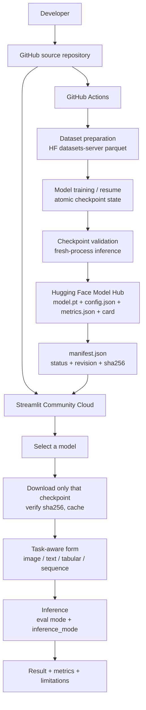

# Deep Learning Models — Medical AI · Smart Agriculture · 20-Model Laboratory

A production-oriented deep-learning platform: **32 models** (a 20-architecture laboratory plus six
computer-vision architectures applied to brain-MRI and plant-disease analysis), a **Streamlit**
frontend that serves predictions without ever training, and **trained checkpoints hosted on the
Hugging Face Hub** rather than committed to git.

> **Evidence over claims.** Every status, metric and availability statement in this README is
> derived from a real artifact or a real test run. Where something is not trained, blocked or
> deferred, it says so.

| | |
|---|---|
| **Source code** | https://github.com/deepvisionkararhaider-crypto/deep-learning-models |
| **Model artifacts** | https://huggingface.co/KararDeepVision/deep-learning-models |
| **Live app** | **Not deployed yet** — see [`docs/DEPLOYMENT.md`](docs/DEPLOYMENT.md) for the exact steps |
| **Registered models** | 32 (20 laboratory · 6 medical · 6 agriculture) |
| **Ready for inference** | 1 (`brain_cnn`, measured test accuracy **0.8585**) |

Badges are intentionally omitted: there is no CI badge, coverage figure or live-URL badge that
could be shown honestly until the workflow has run on the remote and the app is deployed.

---

## Table of contents

1. [What this is](#what-this-is)
2. [Architecture](#architecture)
3. [Model status (verified)](#model-status-verified)
4. [Model inventory](#model-inventory)
5. [Installation](#installation)
6. [Running the app locally](#running-the-app-locally)
7. [Using the app](#using-the-app)
8. [Hugging Face artifact configuration](#hugging-face-artifact-configuration)
9. [The model manifest](#the-model-manifest)
10. [Training](#training)
11. [Resume training](#resume-training)
12. [Publishing checkpoints](#publishing-checkpoints)
13. [GitHub Actions setup](#github-actions-setup)
14. [Streamlit Community Cloud deployment](#streamlit-community-cloud-deployment)
15. [Configuration reference](#configuration-reference)
16. [Testing](#testing)
17. [Troubleshooting](#troubleshooting)
18. [Limitations & responsible use](#limitations--responsible-use)
19. [Security & privacy](#security--privacy)
20. [Project structure](#project-structure)
21. [Roadmap](#roadmap)
22. [Acknowledgements](#acknowledgements)
23. [Licence](#licence)

---

## What this is

Three things in one repository:

1. **A 20-model deep-learning laboratory** — MLP, CNN, RNN, LSTM, GRU, autoencoder, VAE, GAN,
   Transformer, BERT-style, GPT-style, ResNet, DenseNet, ViT, U-Net, YOLO-style, Siamese, Seq2Seq,
   diffusion and a GNN. Each has its **own real dataset** and its **own input/output contract** —
   no shared "generic input" shortcut.
2. **Medical AI** — brain-MRI tumour **classification** (CNN, DenseNet121, ViT), **segmentation**
   (U-Net), **detection** (YOLO-style) and **instance segmentation** (Mask R-CNN).
3. **Smart Agriculture** — plant-leaf **disease classification** (25 classes), leaf-disease
   **segmentation** and cotton-disease **detection**.

**Use cases:** teaching and coursework, reproducible model-serving reference implementations,
comparing architectures on the same data, and a starting point for real medical/agricultural
research pipelines.

**The public app never trains and never downloads a dataset.** It downloads only the checkpoint you
select, verifies its SHA-256, and runs CPU inference.

---

## Architecture



Key design decisions:

- **GitHub stores source only.** Checkpoints are published to the Hub; `ci/validation-ci.yml` fails
  if any tracked file exceeds GitHub's 100 MB limit.
- **Status is derived evidence, not a claim.** `models/manifest.json` is generated from the registry
  plus real artifacts and the published Hub manifest.
- **Inference is isolated from training.** `src/inference.py`, `src/lab_inference.py`,
  `src/hf_loader.py` and the services layer contain no optimiser and no backward pass — asserted by
  tests and by CI.
- **Forms come from metadata.** The UI renders the control a model actually needs; a model with no
  declared schema is marked not-ready rather than given invented fields.

More detail: [`docs/ARCHITECTURE.md`](docs/ARCHITECTURE.md).

---

## Model status (verified)

Derived from `models/manifest.json` at the time of writing:

| Status | Count | Meaning |
|---|---|---|
| `TRAINED_VERIFIED` | **1** | Checkpoint published, downloaded fresh, checksum-matched, inference passed |
| `TRAINED_UNVERIFIED` | 16 | Local checkpoint present; fresh-download verification not yet recorded |
| `ARCH_ONLY` | 13 | Architecture implemented, no trained weights |
| `BLOCKED` | 1 | Cannot be trained — blocker recorded |
| `DEFERRED` | 1 | Intentionally postponed (too heavy for the current runner) |
| `FAILED` | 0 | — |

**Verified model:** `brain_cnn` — 4-class brain-MRI classification, test accuracy **0.8585**,
macro-F1 0.8575, 980,608-byte checkpoint, published at Hub revision `a8bab732d9…`, SHA-256
`97e2b9eb76…`, verified by a fresh download into a clean directory followed by a production-loader
inference run.

Full per-model table: [`docs/MODEL_STATUS.md`](docs/MODEL_STATUS.md).

---

## Model inventory

### Laboratory — the original 20 (all preserved)

| id | Architecture | Task | Dataset |
|---|---|---|---|
| `lab01` | ANN / MLP | tabular classification | Breast Cancer Wisconsin (Diagnostic) |
| `lab02` | CNN | image classification | MNIST |
| `lab03` | RNN | sequence classification | UCI Smartphone HAR |
| `lab04` | LSTM | sequence classification | UCI Smartphone HAR |
| `lab05` | GRU | sequence classification | UCI Smartphone HAR |
| `lab06` | Autoencoder | reconstruction | MNIST |
| `lab07` | VAE | reconstruction | MNIST |
| `lab08` | GAN (discriminator) | binary classification | MNIST |
| `lab09` | Transformer | text classification | 20 Newsgroups (4 classes) |
| `lab10` | BERT-style | text classification | 20 Newsgroups (4 classes) |
| `lab11` | GPT-style | language modelling | 20 Newsgroups corpus |
| `lab12` | ResNet | image classification | MNIST |
| `lab13` | DenseNet | image classification | MNIST |
| `lab14` | ViT | image classification | MNIST |
| `lab15` | U-Net | segmentation | MNIST foreground |
| `lab16` | YOLO-style | detection | MNIST digit localisation |
| `lab17` | Siamese | metric learning | MNIST |
| `lab18` | Seq2Seq | sequence-to-sequence | 20 Newsgroups corpus |
| `lab19` | Diffusion MLP | tabular denoising | Breast Cancer Wisconsin |
| `lab20` | GNN | graph classification | Cora citation network |

### Medical (6)

| id | Architecture | Task | Dataset |
|---|---|---|---|
| `brain_cnn` | CNN (from scratch) | 4-class MRI classification | `PranomVignesh/MRI-Images-of-Brain-Tumor` |
| `brain_densenet` | DenseNet121 (transfer) | 4-class MRI classification | same |
| `brain_vit` | timm ViT-tiny (transfer) | 4-class MRI classification | same |
| `brain_unet` | U-Net | binary tumour segmentation | `dwb2023/brain-tumor-image-dataset-semantic-segmentation` |
| `brain_yolo` | YOLO-style (anchor-free) | tumour detection | `mmenendezg/brain-tumor-object-detection` |
| `brain_maskrcnn` | Mask R-CNN (ResNet-50-FPN) | tumour instance segmentation | same as U-Net |

### Agriculture (6)

| id | Architecture | Task | Dataset |
|---|---|---|---|
| `plant_cnn` | CNN (from scratch) | 25-class leaf classification | `Dipra444/plant-leaf-disease-jharkhand` |
| `plant_densenet` | DenseNet121 (transfer) | 25-class leaf classification | same |
| `plant_vit` | timm ViT-tiny (transfer) | 25-class leaf classification | same |
| `plant_unet` | U-Net | leaf-disease segmentation | `Mauregato/leaf_disease_segmentation` |
| `plant_yolo` | YOLO-style (anchor-free) | cotton disease detection | `Francesco/cotton-plant-disease` |
| `plant_maskrcnn` | Mask R-CNN | leaf instance segmentation | **BLOCKED** — no usable instance-segmentation dataset |

Full catalogue with contracts, splits and metrics: [`docs/MODEL_CATALOG.md`](docs/MODEL_CATALOG.md).

---

## Installation

Requires **Python 3.11+** (3.11 is what CI and Actions use).

### Inference only (what the app needs)

```bash
git clone https://github.com/deepvisionkararhaider-crypto/deep-learning-models.git
cd deep-learning-models
python -m venv .venv && source .venv/bin/activate      # Windows: .venv\Scripts\activate
pip install -r requirements.txt
```

`requirements.txt` is deliberately small: Streamlit, CPU-only PyTorch/torchvision, timm,
`huggingface_hub`, `safetensors`, scikit-learn, scipy, pandas, Pillow, NumPy. No dataset library, no
matplotlib, no test tooling.

### Training / publishing (additional)

```bash
pip install -r requirements-train.txt
```

---

## Running the app locally

```bash
streamlit run app.py
```

Then open <http://localhost:8501>. (`streamlit_app.py` is a one-line shim for deployments that
expect that filename.)

The app is **inference-only**: it will not train, will not download datasets, and will only fetch a
checkpoint when you select that model.

To point the app at a model hub:

```bash
export HF_MODEL_REPO=KararDeepVision/deep-learning-models
streamlit run app.py
```

Without `HF_MODEL_REPO`, the app still works for any model whose weights exist locally under
`artifacts/`, and clearly reports the rest as unavailable.

---

## Using the app

Sidebar navigation:

| Page | What it does |
|---|---|
| **Home** | Landing page, live counts, how it works, source/artifact links |
| **Explore Models** | All 32 models, filterable by domain/task/status, with a manifest download |
| **Image Prediction** | Classification, segmentation, detection, instance segmentation |
| **Text & Tabular Prediction** | Text, feature-vector, sequence and graph models |
| **Medical AI** | Brain-MRI models + responsible-use notes |
| **Agriculture AI** | Plant-disease models + disease notes and field limitations |
| **Deep Learning Labs** | The 20-model catalogue + prediction studio + evaluation table |
| **Model Details** | Full declared contract for any model |
| **Model Evaluation** | Measured metrics per trained artifact |
| **Dataset Explorer** | Every dataset, its task and annotation type |
| **About & Documentation** | Purpose, status vocabulary, responsible AI, configuration |

**Example — image classification.** Sidebar → *Image Prediction* → select `brain_cnn` → upload a
PNG/JPG → **Predict**. You get the predicted class, the score breakdown, a note that the score is
*not* a calibrated probability, the measured test metrics, the confusion matrix and the model's
limitations.

**Example — text classification.** Sidebar → *Text & Tabular Prediction* → select `lab09` →
type a sentence → **Predict**.

**Example — tabular.** Same page → `lab01` → enter 30 comma-separated values → **Predict**. The
form validates the feature count before running.

**Example — segmentation.** *Image Prediction* → `brain_unet` (once trained) → upload → you get the
input, the predicted mask, an overlay, the foreground ratio, and a mask download button.

If a model has no verified checkpoint it is shown as **training required** with the reason — it is
never served with random weights.

---

## Hugging Face artifact configuration

Trained weights live on the Hub, never in git.

**Remote layout**

```
medical/<model_id>/model.pt          # torch state_dict (CPU)
medical/<model_id>/config.json       # architecture + preprocessing contract
medical/<model_id>/metrics.json      # measured metrics, status, SHA-256, revision
medical/<model_id>/model_card.md     # human-readable card
agriculture/<model_id>/…
laboratories/lab01/… lab20/…
manifest.json                        # index of every published artifact
README.md
```

**Environment**

| Name | Where | Purpose |
|---|---|---|
| `HF_MODEL_REPO` | GitHub **variable** + optional app env/secret | e.g. `KararDeepVision/deep-learning-models` |
| `HF_TOKEN` | GitHub **secret** | write token, used **only** by publish; the app never needs it |
| `HF_ARTIFACT_CACHE` | optional | download cache directory (default `~/.cache/dl-models-hf`) |

The app reads public artifacts **anonymously** — no token required, so a deployed app holds no
credentials. `HF_MODEL_REPO` is configuration, never hardcoded: a test asserts the repo id appears
nowhere in the app or inference code.

See [`.env.example`](.env.example) for a template. `.env` and `.streamlit/secrets.toml` are
gitignored.

---

## The model manifest

`models/manifest.json` is the single source of truth for the UI. It is **generated**, never
hand-edited:

```bash
python scripts/build_manifest.py              # from local artifacts only
python scripts/build_manifest.py --remote     # merge the published Hub manifest
python scripts/build_manifest.py --check      # fail if the file is stale (used by CI)
```

Each entry records: id, display name, domain, task, modality, framework, architecture,
build kwargs, input contract (modality/size/channels/mean/std), outputs, classes, dataset and key,
metrics, test-set size, split sizes, training config, checkpoint location (local path, Hub repo,
Hub path, pinned revision), weight size and SHA-256, status, verification state and limitations.

Because the UI reads the manifest, **model counts are never hardcoded** — they cannot drift when a
model is published or retrained.

---

## Training

Training is offline only (or in GitHub Actions). It is the only place `torch.optim` appears.

```bash
# CV models
python scripts/train_models.py --list
python scripts/train_models.py --model brain_cnn --epochs 3 --batch-size 8
python scripts/train_models.py --model medical
python scripts/train_models.py --model all --defer brain_maskrcnn,plant_maskrcnn

# the 20-model laboratory
python scripts/train_lab.py --model all

# report artifact status (never fails merely for untrained models)
python scripts/verify_models.py --require none
```

Useful flags: `--force` (retrain even if a valid checkpoint exists), `--resume`, `--allow-heavy`,
`--require-heavy`, `--defer`.

**Exit codes are honest.** `train_models.py` exits non-zero only when a *required* model fails to
reach `TRAINED_VERIFIED`; `BLOCKED` and explicitly `DEFERRED` models are recorded as such, not
counted as success.

Each run writes `artifacts/<area>/<id>.pt`, `artifacts/metadata/<id>.json`,
`artifacts/status/<id>.json` and `artifacts/status/summary.json`.

Details: [`docs/TRAINING.md`](docs/TRAINING.md).

---

## Resume training

Long CPU runs get interrupted. Full training state is checkpointed after **every epoch** —
model, optimizer, scheduler, epoch, global step, history and Python/NumPy/Torch RNG state — with
**atomic** writes (`state.pt.tmp` → `os.replace`), so a crash can never leave a half-written file
that a later resume would trust.

```bash
python scripts/train_models.py --model brain_densenet --epochs 4 --resume
```

A resume validates the state before using it. If the file is corrupt, truncated, belongs to a
different architecture, or records an epoch ≥ the requested total, it raises `InvalidCheckpoint`,
the trainer logs why, and the run restarts cleanly instead of training from garbage. State is
cleared automatically once the model is saved.

---

## Publishing checkpoints

`scripts/publish_models.py` implements a strict 12-step protocol and refuses to skip steps:

1. confirm training completed and the weights file exists and is non-empty
2. validate the artifact structure (rebuild architecture, `load_state_dict(strict=True)`, run inference)
3. compute the SHA-256 of the weights
4. assemble `config.json`, `metrics.json`, `model_card.md`
5. upload to `HF_MODEL_REPO` (never to GitHub)
6. verify remote availability and resolve the **immutable revision**
7. verify remote size and checksum against the local digest
8. download into a **clean temporary directory**
9. load with the **production loader** and run a real inference smoke test
10. publish the manifest entry (status + revision + SHA-256) to the Hub
11. (workflow) commit only small metadata to GitHub
12. write a machine-readable publish report

```bash
python scripts/publish_models.py --model brain_cnn --dry-run   # validate, upload nothing
python scripts/publish_models.py --model brain_cnn             # publish for real
python scripts/publish_models.py --all-ready
```

Inspect or pre-fetch published artifacts:

```bash
python scripts/fetch_models.py --list
python scripts/fetch_models.py --model brain_cnn
python scripts/fetch_models.py --all-ready
```

Only after step 9 passes does the model become `TRAINED_VERIFIED`.

---

## GitHub Actions setup

**Secret** (Settings → Secrets and variables → Actions → *Secrets*):

| Name | Value |
|---|---|
| `HF_TOKEN` | A **fine-grained** Hugging Face token with **write** access to the model repo only |

**Variable** (same page → *Variables*):

| Name | Value |
|---|---|
| `HF_MODEL_REPO` | `KararDeepVision/deep-learning-models` |

Create the token at <https://huggingface.co/settings/tokens> — choose *Fine-grained*, scope it to
the single model repository, and grant `write`. Never paste a token into an issue, a commit, the
README or a chat. If `HF_TOKEN` is missing the workflow logs a warning, skips publishing, and still
completes all training and verification work.

> **Workflow files must be added through the GitHub UI or by a user/App with the `workflows`
> permission.** The prepared workflows are committed at [`ci/train-models.yml`](ci/train-models.yml)
> and [`ci/validation-ci.yml`](ci/validation-ci.yml); copy them to `.github/workflows/`. See
> [`docs/DEPLOYMENT.md`](docs/DEPLOYMENT.md#adding-the-workflows).

The training workflow supports manual dispatch with: model group (`all` / `medical` /
`agriculture` / `single`), single model id, train-laboratory toggle, epochs (2/3/4), batch size,
include-heavy (Mask R-CNN), resume, publish, and verify-only. Each CV model trains in its **own
matrix job** (`fail-fast: false`, `max-parallel: 2`) so one failure cannot discard the others'
work, and the finalize job rebuilds the manifest and commits **only metadata**.

---

## Streamlit Community Cloud deployment

**Status: not deployed yet.** Nothing below has been performed; no live URL exists.

1. Go to <https://share.streamlit.io> and sign in with GitHub.
2. **New app** → *Deploy a public app from GitHub*.
3. Repository: `deepvisionkararhaider-crypto/deep-learning-models`.
4. Branch: `main`.
5. **Main file path: `app.py`**.
6. *(Optional)* Advanced settings → Secrets:
   ```toml
   HF_MODEL_REPO = "KararDeepVision/deep-learning-models"
   ```
   Do **not** add `HF_TOKEN` — the app only reads public artifacts.
7. **Deploy.** The first build installs `requirements.txt` (a few minutes).

Then verify: open the app, go to *Explore Models*, confirm the ready count, run one prediction on
`brain_cnn`, and check *Model Details* shows the checkpoint size and SHA-256.

Full guide including dependency pinning and memory notes:
[`docs/DEPLOYMENT.md`](docs/DEPLOYMENT.md).

---

## Configuration reference

| Variable | Required | Used by | Meaning |
|---|---|---|---|
| `HF_MODEL_REPO` | recommended | app, scripts, Actions | model repository id, e.g. `owner/name` |
| `HF_TOKEN` | publish only | `publish_models.py`, Actions | write token; **never** needed by the app |
| `HF_ARTIFACT_CACHE` | no | app, `fetch_models.py` | download cache directory |
| `OMP_NUM_THREADS` | no | app | CPU threads (app defaults to 2) |

---

## Testing

```bash
python -m pytest -q tests/          # unit + regression suite
python scripts/smoke_app.py         # app health / inference-only guarantees
python scripts/build_manifest.py --check
python scripts/verify_models.py --require none
```

**Current result: `125 passed, 1 skipped`.**

What the suite covers:

- **Manifest/inventory** — all 20 lab ids preserved, ids unique, every entry has a task and
  modality, ready entries carry artifact + input metadata, blocked models carry a reason, status is
  *derived* (a record claiming VERIFIED with no weights is downgraded to `ARCH_ONLY`).
- **Hugging Face** — path construction, revision pinning, download caching, SHA-256/checksum
  mismatch detection, missing/unavailable artifacts, auth-failure handling (fails fast, no retry),
  corrupt checkpoint handling, retry/backoff. **All network calls are mocked**; the suite never
  downloads a model.
- **Inference** — architecture-specific loading, preprocessing parity, output shapes, label
  decoding, CPU inference, invalid input handling.
- **Forms** — form kind derived from the contract, an image model is never given a text form,
  upload size/type validation.
- **Training/publishing** — resume round-trip, finished-state rejection, corrupt-state rejection,
  architecture-mismatch rejection, atomic write, no false success after a failed verification, no
  large checkpoint committed.
- **App** — entry points parse, smoke test passes, no optimiser/backward in the inference path.

The skipped test is a network-dependent dataset check that is intentionally opt-in.

---

## Troubleshooting

| Symptom | Cause | Fix |
|---|---|---|
| `HF_MODEL_REPO is not set` | configuration missing | set the variable (or the app secret) |
| `HF_TOKEN is not set; publishing requires a write token` | secret missing | add it under Actions → Secrets; publishing is skipped otherwise |
| `Artifact 'x' is not fully published` | upload incomplete | re-run `publish_models.py --model x` |
| `Checksum mismatch … refusing to load` | corrupt/truncated download | clear `HF_ARTIFACT_CACHE` and retry |
| Model shows *training required* | no verified checkpoint | train + publish, or accept it is unavailable |
| `checkpoint is incompatible with the current architecture` | weights predate a model change | retrain and republish |
| `resume state unusable` | interrupted write / config change | the run restarts cleanly; state is discarded |
| Push rejected: `without 'workflows' permission` | App lacks the scope | add the workflow via the GitHub UI |
| App OOM on Community Cloud | too many cached models | the cache is capped at 3; reload the app |
| `No module named 'timm'` | inference deps missing | `pip install -r requirements.txt` |

---

## Limitations & responsible use

**Medical models.** Research prototypes, **not medical devices**. Outputs are statistical estimates,
are not diagnoses, have not been prospectively validated and must not drive treatment. Class
balance, scanner and population biases from the source corpora are inherited. Patient-disjointness
is inherited from the source dataset and is not independently re-verified.

**Agricultural models.** Decision support only. Domain shift is real: performance on a different
device, lighting or growth stage is not guaranteed. The cotton detector was trained on boxes only a
few pixels wide in 640×640 images, so its recall is genuinely very low — documented, not hidden.
Agriculture instance segmentation is `BLOCKED` because no instance-level dataset with a usable
parquet mirror exists; no model is offered rather than faking masks.

**Scores are not calibrated probabilities.** Calibration was not evaluated on external data.

**Known technical limitations.** CPU-only inference; Mask R-CNN is `DEFERRED` because it needs
several GB of RAM. The single-scale YOLO-style detector cannot represent sub-cell objects. Reported
metrics reflect the source datasets' own splits.

**Predictions can be wrong.** Always verify against the original image and professional judgement.

---

## Security & privacy

- **No secrets in code.** `HF_TOKEN` is read from the environment and is never logged, printed or
  written by this repository. Tokens were never committed.
- **Uploads are validated, not trusted.** Size limit (15 MB, with a 20 MB server backstop) and a real
  decode attempt; filenames and browser MIME types are ignored.
- **Uploaded files are never executed**, never written to disk, and never sent to a third party.
- **No visitor data is persisted.** Images and text are processed in-session only.
- **The app holds no write credentials** and reads public artifacts anonymously.
- **Arbitrary model repos are not loadable.** The loader reads only `HF_MODEL_REPO`; there is no
  user-supplied repository id anywhere in the app.
- **CI enforces the size limit** and fails if a tracked file exceeds 100 MB.

Details: [`docs/SECURITY.md`](docs/SECURITY.md).

> **Token hygiene note.** If a Hugging Face token has ever been shared in plaintext (a chat, an
> issue, a screenshot), rotate it at <https://huggingface.co/settings/tokens> and update the
> `HF_TOKEN` secret.

---

## Project structure

```
.
├── app.py                      # Streamlit entry point (main file path)
├── streamlit_app.py            # alternate entry point shim
├── requirements.txt            # inference-only deps (Community Cloud)
├── requirements-train.txt      # training/publishing extras
├── .env.example                # configuration template (no secrets)
├── .streamlit/config.toml      # theme + upload limit
├── models/manifest.json        # GENERATED single source of truth (32 models)
├── src/
│   ├── registry.py             # architecture + contract definitions
│   ├── artifacts.py            # local artifact persistence + status helpers
│   ├── manifest.py             # manifest builder (status derived from evidence)
│   ├── hf_hub.py               # Hugging Face layout, hashing, retries, upload/download
│   ├── hf_loader.py            # Hub-first, architecture-specific model loading
│   ├── training_state.py       # atomic resume state (optimizer/scheduler/RNG)
│   ├── inference.py            # CV inference runtime (never trains)
│   ├── lab_inference.py        # per-lab-model inference (never trains)
│   ├── imaging.py              # decode/preprocess/overlay/draw helpers
│   ├── models/                 # classifiers, segmentation, detection, lab20
│   ├── datasets/               # loaders (offline trainer only)
│   ├── services/               # manifest_service, model_loader, prediction_service
│   ├── forms/                  # dynamic, metadata-driven prediction forms
│   └── ui/                     # pages, catalog, results, design system
├── scripts/
│   ├── train_models.py         # CV training (statuses, resume, fresh-load check)
│   ├── train_lab.py            # 20-model laboratory training
│   ├── verify_models.py        # honest artifact verification (--require)
│   ├── publish_models.py       # 12-step Hub publish protocol
│   ├── fetch_models.py         # download published artifacts
│   ├── build_manifest.py       # regenerate models/manifest.json
│   ├── smoke_app.py            # app health / inference-only guarantees
│   └── _fetch_data.py          # dataset downloader (trainer only)
├── tests/                      # 126 tests (125 pass, 1 skipped)
├── ci/                         # workflows to copy into .github/workflows/
├── docs/                       # ARCHITECTURE, MODEL_CATALOG, TRAINING, INFERENCE,
│                               # DEPLOYMENT, MODEL_STATUS, SECURITY
├── DATASETS.md                 # verified dataset facts + licences
└── artifacts/                  # local training output (checkpoints gitignored)
```

---

## Roadmap

- [ ] Run the training workflow on the runner and publish the remaining 11 CV models
- [ ] Train and publish the 20 laboratory models
- [ ] Deploy the Streamlit app and record the verified public URL
- [ ] Add mask-AP evaluation for the instance-segmentation models (COCO evaluator)
- [ ] Add a patient-disjointness check for the medical datasets
- [ ] Confidence calibration (temperature scaling) with an honest reliability diagram
- [ ] Multi-scale detection so sub-cell objects become representable

---

## Acknowledgements

Datasets are the work of their original authors and are used under their own terms:

- `PranomVignesh/MRI-Images-of-Brain-Tumor` — brain-MRI 4-class classification
- `dwb2023/brain-tumor-image-dataset-semantic-segmentation` — tumour polygons
- `mmenendezg/brain-tumor-object-detection` — tumour detection boxes
- `Dipra444/plant-leaf-disease-jharkhand` — 25-class plant leaf disease
- `Mauregato/leaf_disease_segmentation` — leaf-disease masks
- `Francesco/cotton-plant-disease` — cotton disease detection
- MNIST (LeCun et al.), UCI Breast Cancer Wisconsin (Diagnostic), UCI Smartphone HAR,
  20 Newsgroups, Cora (Yang et al.), Planetoid

Model code builds on PyTorch, torchvision, timm, Hugging Face `huggingface_hub` and Streamlit.
See [`DATASETS.md`](DATASETS.md) for row counts, splits, annotation formats and licence notes.

---

## Licence

This repository does **not** currently ship a `LICENSE` file. Until one is added, the code is
"all rights reserved" by default and **not** open for reuse — add a licence (MIT/Apache-2.0 are
common choices) to make reuse explicit. Dataset licences are separate and belong to their original
authors; check each source before redistribution or commercial use.
