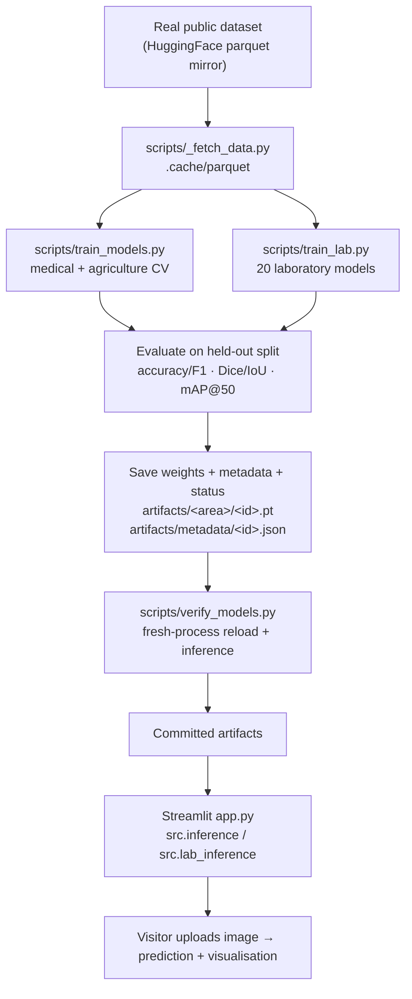

# Deep Learning · Medical AI · Smart Agriculture — Streamlit Platform

A single **Streamlit** application combining three things:

1. **A 20-architecture deep-learning laboratory** (MLP, CNN, RNN/LSTM/GRU, Autoencoder, VAE, GAN,
   Transformer, BERT-style, GPT-style, ResNet, DenseNet, ViT, U-Net, YOLO-style, Siamese, Seq2Seq,
   Diffusion, GNN).
2. **Medical AI** — brain-MRI tumour **classification**, **segmentation**, **detection** and
   **instance segmentation**.
3. **Smart Agriculture AI** — plant-leaf **disease classification** (25 classes), leaf-disease
   **segmentation**, and cotton disease **detection**.

The six required computer-vision model types — **CNN, DenseNet121, Vision Transformer, U-Net,
YOLO-style, Mask R-CNN** — are instantiated for both the medical and agricultural domains.

> **Inference only.** The public app never trains and never downloads datasets. Models are trained
> **offline** (locally or in GitHub Actions) and shipped as committed artifacts under `artifacts/`.
> When weights are missing the UI says **"training required"** — it never presents random weights as
> a trained model.

---

## Project status (read this first)

| | |
|---|---|
| Registered models | 32 (12 CV + 20 lab) |
| Lab models with committed weights | 16 READY, 3 BELOW-GATE (lab12/13/14), 1 MISSING (lab16) |
| CV models with committed weights | **0** — `artifacts/medical/` and `artifacts/agriculture/` are not in the repo yet |
| How the CV models get trained | `workflow_dispatch` on **Train models and publish artifacts** (see below) |

**Why there were previously no CV checkpoints.** The old workflow ran `scripts/verify_models.py`
*before* its commit step, and that script returned a nonzero exit code whenever any model was merely
*untrained* (not broken). The nonzero exit aborted the job, so **every trained checkpoint was
discarded before it could be committed.** This has been fixed in three ways:

* `verify_models.py` now separates **MISSING / DEFERRED / BLOCKED** (not a defect) from
  **INFER-FAILED** (a real defect), and `--require` controls what is actually mandatory.
* Training is now **one matrix job per model**, so a single failing model cannot throw away the
  others' work.
* Artifacts are uploaded from every job and merged in a final `publish` job that commits **only
  after** verification passes.

Run the workflow once and the CV table below fills in with real, measured numbers.

---

## Quick start (local, inference only)

```bash
pip install -r requirements.txt          # runtime (inference only, CPU torch + timm)
streamlit run app.py                     # http://localhost:8501
```

## Train the models (offline)

```bash
pip install -r requirements-train.txt

# --- computer-vision models (medical + agriculture) ---
python scripts/_fetch_data.py                    # cache the CV datasets
python scripts/train_models.py --list
python scripts/train_models.py --model brain_densenet --epochs 4
python scripts/train_models.py --model all --epochs 4 --batch-size 8 \
       --defer brain_maskrcnn,plant_maskrcnn     # heavy detectors deferred on purpose
python scripts/train_models.py --model brain_maskrcnn --allow-heavy   # only if you have RAM

# --- the 20-model laboratory ---
python scripts/train_lab.py --model all

# --- verify (fresh-process reload + inference for every model) ---
python scripts/verify_models.py --require cv
pytest -q tests/
```

Each run writes `artifacts/<area>/<id>.pt`, `artifacts/metadata/<id>.json`, a per-model
`artifacts/status/<id>.json` record and a machine-readable `artifacts/status/summary.json`.

### Honest model states

| State | Meaning |
|---|---|
| `TRAINED_VERIFIED` | weights saved **and** reloaded from disk in a fresh process with inference OK |
| `TRAINED_UNVERIFIED` | weights saved but the fresh-load check failed |
| `ARCH_ONLY` | architecture builds, no weights produced |
| `BLOCKED` | no usable dataset exists — cannot be trained at all |
| `DEFERRED` | skipped on purpose via `--defer` (recorded, never silently dropped) |
| `FAILED` | training or evaluation raised |

`scripts/train_models.py` returns exit code **0 only when every required model is
`TRAINED_VERIFIED`**. `scripts/verify_models.py` returns **0 only when every required model is
`READY` and no model is `INFER-FAILED`**.

---

## GitHub Actions: train and publish

Workflow: **`.github/workflows/train-models.yml`** (`workflow_dispatch`).

Inputs: `train_lab`, `train_cv`, `cv_epochs` (2/3/4), `include_heavy`, `defer`, `publish`.

Pipeline:

```
validate  (compile + unit tests + report-only verify)      ~5 min
   ├── train-lab        (20 lab models, one job)           ~10 min
   └── train-cv         (matrix: one job per CV model)     ~30-90 min
publish  (download all artifacts → merge → verify --require cv → size check → commit+push)
```

To trigger it: **Actions → Train models and publish artifacts → Run workflow** (leave
`defer=brain_maskrcnn,plant_maskrcnn` unless you have ≥8 GB RAM and want the heavy detectors).

---

## Architecture



Guarantees enforced in code:

* **Preprocessing parity** — `src/imaging.to_tensor()` is the *only* image→tensor path and the
  normalisation constants are read back from each artifact's metadata, so training and inference
  cannot drift (`test_to_tensor_matches_make_transform`).
* **No training at inference** — `src/inference.py` and `src/lab_inference.py` contain no
  `torch.optim` and no `.backward()` (asserted by a CI test).
* **Leakage-free splits** — `files_for(key, split)` never returns another split's rows, and cached
  parquet is named `<split>-<index>.parquet` with `validation`/`valid`/`val` canonicalised
  (`test_files_for_never_returns_other_splits`).
* **Honest status** — a model is only shown as trained when its weights load *and* an inference
  smoke test passes.

---

## Repository structure

```
app.py                     Streamlit entry point (main file path)
requirements.txt           runtime deps (CPU torch, timm, streamlit, …)
requirements-train.txt     extra deps for offline training (pyarrow, matplotlib)
src/
  registry.py              single source of truth: 32 models, tasks, datasets, IO contracts
  artifacts.py             save/load weights + metadata + status; graceful missing handling
  imaging.py               shared preprocessing (train == inference)
  inference.py             CV predictors (classification / segmentation / detection / instances)
  lab_inference.py         the 20 lab predictors, each with its own input contract
  models/                  classifiers.py · segmentation.py · detection.py · lab20.py
  datasets/                loaders.py (CV) · lab_datasets.py (20-model datasets)
  ui/                      home · medical · agriculture · lab · info pages
scripts/
  _fetch_data.py           resumable dataset downloader
  train_models.py          train medical/agriculture CV models (structured status records)
  train_lab.py             train the 20 lab models
  verify_models.py         report REAL status; --require cv|all|none
tests/
  test_platform.py         registry, shapes, IO contracts, no-training-at-inference
  test_pipeline.py         leakage, detection/segmentation math, artifacts, status contract
artifacts/                 medical/ · agriculture/ · lab/ · metadata/ · status/
DATASETS.md                dataset sources, licences, annotation formats, sample counts
```

---

## Model catalogue

### Computer-vision models (medical)

| Model | Task | Dataset | Metric | Architecture |
|---|---|---|---|---|
| `brain_cnn` | 4-class MRI classification | Brain MRI (PranomVignesh) | accuracy, macro-F1 | small CNN, from scratch |
| `brain_densenet` | 4-class MRI classification | Brain MRI | accuracy, macro-F1 | DenseNet121, ImageNet-pretrained |
| `brain_vit` | 4-class MRI classification | Brain MRI | accuracy, macro-F1 | **timm `vit_tiny_patch16_224`, ImageNet-pretrained** |
| `brain_unet` | tumour segmentation | Brain tumour COCO polygons → binary mask | Dice, IoU | U-Net, from scratch |
| `brain_yolo` | tumour detection | Brain tumour detection (COCO boxes) | mAP@50 | YOLO-style anchor-free, from scratch |
| `brain_maskrcnn` | tumour instances | Brain tumour COCO polygons | mean instances / confidence | Mask R-CNN ResNet-50-FPN |

### Computer-vision models (agriculture)

| Model | Task | Dataset | Metric | Architecture |
|---|---|---|---|---|
| `plant_cnn` | 25-class leaf classification | Plant leaf disease (Jharkhand) | accuracy, macro-F1 | small CNN, from scratch |
| `plant_densenet` | 25-class leaf classification | Plant leaf disease | accuracy, macro-F1 | DenseNet121, ImageNet-pretrained |
| `plant_vit` | 25-class leaf classification | Plant leaf disease | accuracy, macro-F1 | **timm `vit_tiny_patch16_224`, ImageNet-pretrained** |
| `plant_unet` | leaf-disease segmentation | Leaf disease segmentation | Dice, IoU | U-Net, from scratch |
| `plant_yolo` | cotton disease detection | Cotton plant disease (COCO boxes) | mAP@50 | YOLO-style anchor-free, from scratch |
| `plant_maskrcnn` | leaf instances | — | — | **BLOCKED** (no accessible instance-seg dataset) |

### Laboratory models (20)

| # | Model | Task | Dataset |
|---|---|---|---|
| 1 | ANN / MLP | tabular classification | Breast Cancer Wisconsin |
| 2 | CNN | 10-class digit classification | MNIST |
| 3–5 | RNN / LSTM / GRU | sequence classification | UCI Smartphone HAR |
| 6 | Autoencoder | reconstruction | MNIST |
| 7 | VAE | reconstruction + latent | MNIST |
| 8 | GAN (discriminator) | real/fake classification | MNIST |
| 9–10 | Transformer / BERT-style | 4-class text classification | 20 Newsgroups |
| 11 | GPT-style | char language modelling | 20 Newsgroups |
| 12–14 | ResNet / DenseNet / ViT | 10-class digit classification | MNIST |
| 15 | U-Net | foreground segmentation | MNIST (derived) |
| 16 | YOLO-style | digit localisation | MNIST (derived) |
| 17 | Siamese | metric learning | MNIST |
| 18 | Seq2Seq | char reconstruction | 20 Newsgroups |
| 19 | Diffusion MLP | tabular denoising | Breast Cancer Wisconsin |
| 20 | GNN | 7-class node classification | Cora |

Full dataset sources, licences, annotation formats and sample counts: **[DATASETS.md](DATASETS.md)**.

---

## Known limitations (honest)

* **`plant_yolo` is expected to score near zero mAP@50.** Its source dataset annotates each diseased
  region as a **~2.5 × 2.5-pixel spot** inside a 640 × 640 image. A single-scale 14 × 14-grid detector
  cannot represent an object smaller than one cell (≈46 px), so the metric is a **data-scale
  limitation**, not a training bug. It is reported honestly rather than hidden. A proper fix needs a
  higher-resolution / multi-scale head or a different dataset — documented, not faked.
* **`brain_maskrcnn` / `plant_maskrcnn`** are heavy detectors (ResNet-50-FPN). They are `DEFERRED`
  unless `--allow-heavy` is passed and the runner has several GB of RAM.
* **`plant_maskrcnn` is `BLOCKED`**: the only candidate agriculture instance-segmentation dataset
  (`daiv05/corn-leaf-instance-segmentation`) has no parquet conversion, so it cannot be fetched.
  No agriculture instance masks are fabricated from semantic masks.
* **lab12/13/14 (MNIST ResNet/DenseNet/ViT) are `BELOW-GATE`** — their compact from-scratch MNIST
  nets sit below the 0.90 serving gate. They are hidden from the prediction selector rather than
  presented as reliable.
* **Not clinically or agronomically validated.** No external cohort, no prospective testing, no
  regulatory review.

---

## Responsible AI

**Medical:** research/educational prototype, **not a medical device**. Outputs are not diagnoses and
must not drive treatment. Consult a clinician.
**Agriculture:** decision-support only; predictions can be wrong. Verify important findings with an
agronomist. No personal or medical data is collected or stored — uploads are processed in-session.

## Troubleshooting

| Symptom | Fix |
|---|---|
| "training required" badge | Train offline: `python scripts/train_models.py --model <id>` |
| `ArtifactIncompatible` | Architecture changed — retrain that model |
| Slow first load | Weights load once per session (`st.cache_resource`) |
| Streamlit Cloud build fails | Ensure `requirements.txt` is at the repo root and uses CPU torch |
| Workflow can't push artifacts | Repo → Settings → Actions → Workflow permissions → *Read and write* |

## Licence

Code: MIT. Datasets retain their own licences — see [DATASETS.md](DATASETS.md).
