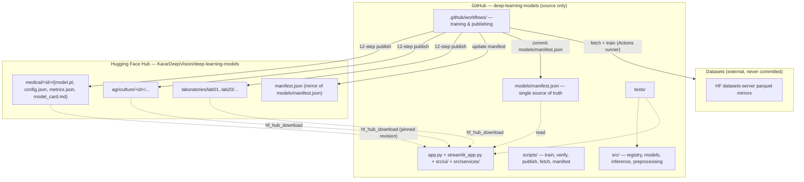

# Architecture

This repository is a **source-only GitHub repository**. Trained weights live on the
**Hugging Face Hub**; the Streamlit app is an **inference-only** front end that pulls the
weights it needs at request time.

## System diagram

## Layers

| Layer | Module(s) | Responsibility |
|---|---|---|
| Registry | `src/registry.py` | `ModelSpec` definitions for all 32 models (6 medical, 6 agriculture, 20 labs); `build_model()`; `normalisation_for()` |
| Artifacts | `src/artifacts.py` | Local artifact I/O, status files, `weights_path`, `has_weights`, `save_model`, `load_model` |
| Hub layer | `src/hf_hub.py` | Repo/path construction, SHA-256, retries, upload/download/verify, manifest build/read |
| Manifest | `src/manifest.py` | Builds `models/manifest.json`; derives status from evidence; modality mapping |
| Loader | `src/hf_loader.py` | Architecture-specific checkpoint resolution and loading, Hub-first with `NotPublished` |
| Inference | `src/inference.py`, `src/lab_inference.py` | Task-specific predict functions (classification, segmentation, detection, instance seg, tabular, sequence, text, graph, siamese) |
| Training state | `src/training_state.py` | Atomic resume state (model + optimizer + scheduler + epoch + step + RNG) |
| App services | `src/services/` | `manifest_service`, `model_loader`, `prediction_service` — cached, manifest-driven |
| Forms | `src/forms/prediction_forms.py` | Dynamic input forms generated from each model's declared contract |
| UI | `src/ui/` | Design system (`common.py`), result rendering (`results.py`), catalogue (`catalog.py`), studio (`predict.py`), 11 pages |
| Scripts | `scripts/` | `train_models.py`, `train_lab.py`, `verify_models.py`, `publish_models.py`, `fetch_models.py`, `build_manifest.py`, `smoke_app.py` |

## Data flow — publishing

1. Actions runner fetches the dataset from its parquet mirror.
2. `scripts/train_models.py` trains, writing local checkpoints under `artifacts/`.
3. `scripts/publish_models.py` runs the 12-step protocol: smoke test the checkpoint by
   rebuilding the architecture and loading it strictly, assemble `config.json`,
   `metrics.json`, `model_card.md`, compute SHA-256, upload to the pinned Hub path, then
   **re-download the artifact fresh and run inference on it** before marking it verified.
4. `scripts/build_manifest.py --remote` merges Hub evidence into `models/manifest.json`.
5. The workflow commits only `models/manifest.json`, `artifacts/status/**` and
   `artifacts/metadata/**` (with `[skip ci]`). Checkpoints never enter Git history.

## Data flow — inference

`app.py` → `src/services/manifest_service.py` (reads the manifest) →
`src/forms/prediction_forms.py` (builds the input form for the declared modality) →
`src/services/prediction_service.py` → `src/hf_loader.py` (pinned revision download,
`st.cache_resource`) → `src/inference.py` / `src/lab_inference.py` →
`src/ui/results.py` (task-specific rendering).

## Status contract

| Status | Meaning |
|---|---|
| `TRAINED_VERIFIED` | Weights exist, were re-downloaded fresh from the Hub and passed inference verification |
| `TRAINED_UNVERIFIED` | Weights exist locally but have not passed fresh-download verification |
| `ARCH_ONLY` | Architecture is defined and importable; no weights |
| `BLOCKED` | Cannot proceed — the blocker is recorded in the manifest `note` |
| `DEFERRED` | Deliberately postponed (e.g. too heavy for the available runner) |
| `FAILED` | A required run failed |

Only `TRAINED_VERIFIED` models are presented as ready in the app. A claimed
`TRAINED_VERIFIED` is automatically downgraded to `ARCH_ONLY` when no weights exist.
